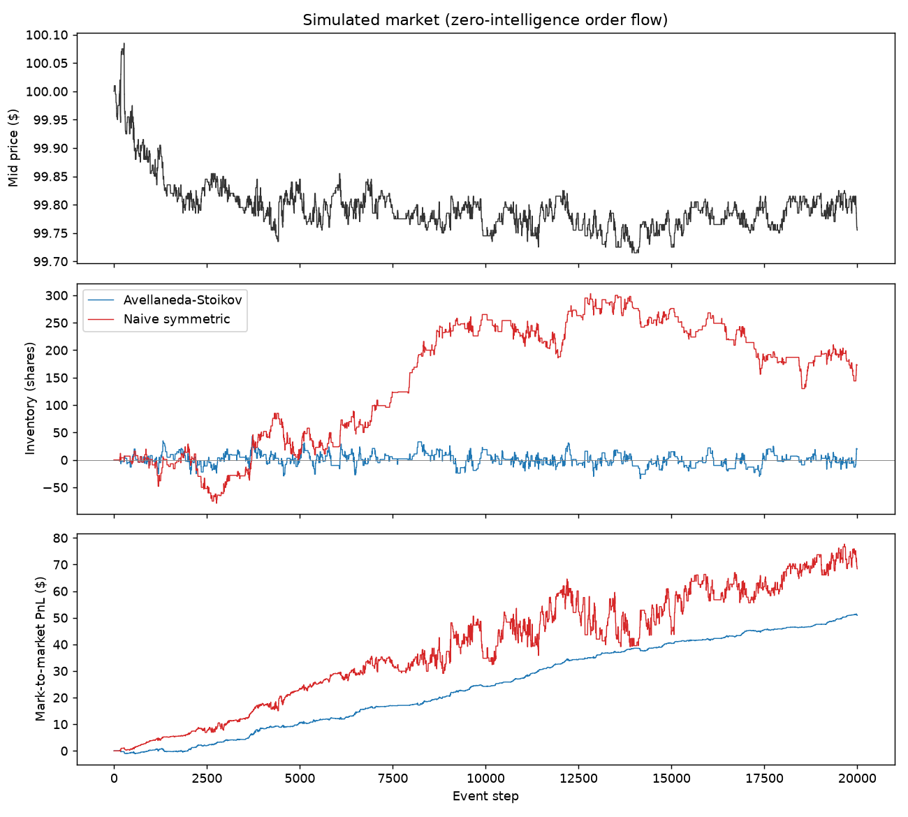

# lob-engine

[](https://github.com/saamaaraiii/lob-engine/actions/workflows/ci.yml)


A limit order book and matching engine in Python, plus a small simulated market I use to test a market-making strategy.

Every exchange has one of these at its core. Orders come in, get matched by price-time priority (best price first, then whoever was there first), and anything left over sits in the book. I wanted to understand how that actually works, so I built one and then tried to make money market-making on top of it.



## What's in here

The engine supports limit and market orders, GTC/IOC/FOK time-in-force, cancels, and amends. Amends work the way real exchanges do: cutting your size keeps your place in the queue, anything else sends you to the back.

Prices are integer ticks rather than floats, so matching never depends on floating-point comparisons.

On my laptop it handles about 770k operations a second, with p99 latency under 5 µs. That's pure Python, so there's a lot of room left if I ever port the core to Rust.

For testing I wrote a deliberately slow, obviously-correct reference matcher (it just scans lists), and Hypothesis throws thousands of random order sequences at both. They have to produce identical trades and identical books, and the fast engine's internal invariants get checked after every single step. It's the test I trust most, because the reference is simple enough to check by eye.

## How it's built

```
                 submit(order)
                      │
        ┌─────────────▼─────────────┐
        │  FOK? check liquidity     │──── not enough ──► REJECTED
        └─────────────┬─────────────┘
                      ▼
        ┌───────────────────────────┐
        │  match against opposite   │   best price first; within a price,
        │  side while prices cross  │   oldest order first (FIFO)
        └─────────────┬─────────────┘
                      ▼
     remainder? ── GTC limit ──► rest in book (NEW / PARTIALLY_FILLED)
                └─ IOC / market ─► CANCELLED
```

| Structure | Why | Cost |
|---|---|---|
| `SortedDict[price → PriceLevel]` per side | best bid/ask and walking levels in order | O(1) top of book, O(log L) new level |
| `OrderedDict[order_id → Order]` per level | FIFO queue at each price | O(1) pop front, O(1) cancel anywhere |
| `dict[order_id → Order]` | find any resting order | O(1) |

Trades print at the resting order's price, so the aggressive side gets any price improvement.

## Quick start

```bash
git clone https://github.com/saamaaraiii/lob-engine.git
cd lob-engine
pip install -e ".[dev]"
pytest
```

```python
from lob import Order, OrderBook, OrderType, Side, TimeInForce

book = OrderBook("ACME")
book.submit(Order(1, Side.SELL, 100, price=10_050))  # prices are in ticks
book.submit(Order(2, Side.SELL, 50, price=10_040))
book.submit(Order(3, Side.BUY, 80, price=10_000))

report = book.submit(Order(4, Side.BUY, 120, order_type=OrderType.MARKET))
print(report.status, report.average_price)  # FILLED 10045.83...
print(book.depth(5))  # bids=[(10000, 80)], asks=[(10050, 30)]

book.submit(Order(5, Side.SELL, 500, price=9_990, tif=TimeInForce.FOK))  # REJECTED: not enough bids
```

## Benchmark

```bash
python benchmarks/bench.py --orders 1000000
```

The flow is 60% limit orders near the touch, 10% market orders and 30% cancels. Each engine call is timed on its own.

| Metric | Result (Apple Silicon, Python 3.11) |
|---|---:|
| Engine throughput | ~767,000 ops/sec |
| End to end, including order generation | ~359,000 ops/sec |
| Latency p50 / p99 / p99.9 | 1.1 µs / 4.6 µs / 8.5 µs |
| Resting orders at the end | 255,761 |

## The market-making experiment

```bash
python examples/market_making.py
```

The background market is zero-intelligence order flow (Farmer, Patelli & Zovko, 2005): limit orders land at random distances from the best price, market orders arrive at random, and resting orders get cancelled at random. It sounds too simple to be useful, but it produces a surprisingly realistic book.

The market maker follows Avellaneda & Stoikov (2008). It quotes around a reservation price that moves away from its inventory, and widens its spread when volatility goes up:

$$r = s - q\,\gamma\,\sigma^2\,\tau \qquad \delta = \gamma\,\sigma^2\,\tau + \tfrac{2}{\gamma}\ln\!\left(1+\tfrac{\gamma}{k}\right)$$

Here $s$ is the mid, $q$ is inventory in lots, $\gamma$ is risk aversion, $\sigma^2$ is an EWMA estimate of mid-price variance, $\tau$ is the horizon and $k$ is the order-arrival decay. To compare, I ran a naive quoter with the same spread but no inventory skew, on exactly the same order flow (same seeds).

Averages over 10 seeds × 20,000 events:

| Metric | Avellaneda-Stoikov | Naive symmetric |
|---|---:|---:|
| PnL per 1k steps (ticks) | 238.57 | 349.16 |
| Sharpe (per 1k steps) | 1.92 | 0.40 |
| Inventory std (shares) | 10.74 | 82.54 |
| Max abs inventory (shares) | 38.50 | 268.10 |
| Volume traded (shares) | 6,504.70 | 6,419.80 |

The naive quoter makes more money on paper. Look at its inventory line in the chart, though: it's sitting on a few hundred shares it never hedges, and its PnL swings all over the place. The A-S quoter gives up some return to keep inventory near zero. That's the trade-off a real market maker is managing all day.

## Layout

```
src/lob/
  orders.py       Order, Trade, ExecutionReport and enums
  book.py         OrderBook: matching, cancel, amend, depth, imbalance
  simulation.py   zero-intelligence flow + Avellaneda-Stoikov market maker
tests/
  test_book.py            unit tests for each order type and edge case
  test_differential.py    Hypothesis differential test vs. a reference matcher
  test_simulation.py      determinism, PnL accounting, strategy behaviour
benchmarks/bench.py       throughput and latency percentiles
examples/market_making.py strategy comparison and the charts above
```

## Things I'd add next

- Self-trade prevention and per-participant risk limits
- Replaying real L3 data (LOBSTER, say) through the engine
- A Rust or Cython core behind the same Python API

## References

- Avellaneda, M. & Stoikov, S. (2008). *High-frequency trading in a limit order book*. Quantitative Finance, 8(3).
- Farmer, J. D., Patelli, P. & Zovko, I. (2005). *The predictive power of zero intelligence in financial markets*. PNAS, 102(6).
- Gould, M. D. et al. (2013). *Limit order books*. Quantitative Finance, 13(11).
